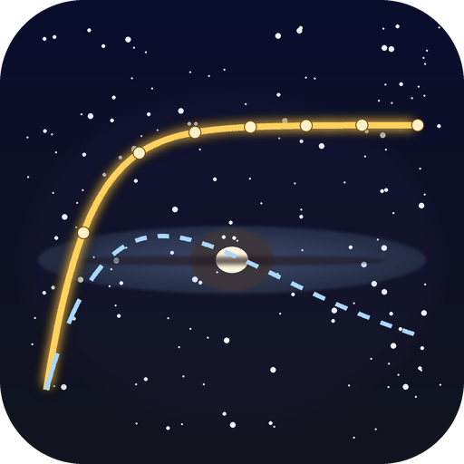

<p align="center"></p>

# Galaxy Rotation Curves

*How much mass is missing? Rotation curves of 409 galaxies and of the Milky Way, with visible matter, dark-matter haloes and MOND* — original Italian name: «Curve di rotazione»

Stars and gas in a disc galaxy orbit its centre; the rotation curve tells how fast they move at each radius. If almost all the mass were in the stars and gas we see, far from the centre the speed should drop like the planets around the Sun. Instead it stays flat. This program puts the measured curve next to the curve that visible matter alone would give, and shows **how much mass is missing**.

It contains the 175 galaxies of **SPARC** (Lelli, McGaugh & Schombert 2016: rotation curves from HI and Hα, and gas, disc and bulge components from Spitzer 3.6 µm photometry); since version 1.1 also 232 galaxies from the 2026 rotation-curve corpus by Flynn (THINGS, LITTLE THINGS and WALLABY DR2: observed curves only, so the whole mass is given to the halo), **M 33** (Kam et al. 2017) and the **Milky Way**, built from the author's own 21-cm measurements with the SALSA radio telescopes (see [Hydrogen 21 cm](https://github.com/EDOKILLER/hydrogen-21cm)) plus Eilers et al. 2019, with the stellar model of Pouliasis et al. 2017 and the gas discs of McMillan 2017.

## Features

* Five mass models fitted to every galaxy: **NFW** (cuspy halo from cosmological simulations), **Burkert** and **pseudo-isothermal** (cored haloes), **Einasto** (rolling slope, as in modern simulations) and **MOND** (no dark matter); disc mass-to-light ratio free (log-normal prior 0.5 ± 0.1 dex, as Li et al. 2020) or fixed
* Distance and inclination free within their published errors (Gaussian priors, as Li et al. 2020) or fixed
* SPARC galaxies also observed by THINGS or LITTLE THINGS show the second curve for comparison
* Comparison with the published fits of Li et al. 2020 for each galaxy and model
* Overview plots: baryonic Tully-Fisher relation, radial acceleration relation (McGaugh et al. 2016), dark-matter fraction; the Milky Way marked in all of them
* Optical (Legacy Survey DR10, DSS2 outside its footprint) and infrared (unWISE) images with the last measured radius and a kpc scale bar
* *All galaxies*: the five models on 409 galaxies in about three minutes, table, CSV and summary PDF
* Built with a shared Tk window library (`finestra_comune.py` 1.1): text size 100–200 %, layout self-checked at three scales

## Tested on real data

NGC 3198 (the classic flat curve), Burkert halo with free distance and inclination: D = 14.70 Mpc, i = 73.6°, Υ_disc = 0.66, r0 = 9.94 kpc (Li et al. 2020: 14.69, 73.8, 0.66, 9.95); NFW χ²_red = 1.46 (Li: 1.46); Einasto rs = 13.8 kpc, α = 0.35 (Li: 13.6, 0.36). Over all 175 SPARC galaxies the fitted Burkert Υ_disc agrees with Li et al. 2020 with a median difference of 0.000 dex (scatter 0.115 dex). Best model by χ² (free D and i): Einasto 65, Burkert 48, pseudo-isothermal 48, NFW 8, MOND 6 galaxies. DDO 154: 87 % of the mass at the last radius is dark. Milky Way (author's SALSA points + Eilers et al. 2019, stars + gas): NFW M200 = 7.1 × 10¹¹ M☉ (Eilers et al.: 7.25 × 10¹¹).

> **Language note.** The interface is in **Italian** (large, adjustable text); plots, PDF/PNG cards and scientific output are in **English**. Code comments are in Italian. The original Italian guide is [`LEGGIMI.txt`](LEGGIMI.txt).

**Version:** 1.1 (2026-11-25). **Status:** self-test 18/18 on the author's PC (window checked at 100/150/200 %). Version 1.0 (same day): SPARC, M 33 and the Milky Way with four models.

## Quick start

Requirements: Python 3.10+ (tested with Python 3.14 on Ubuntu) with `tkinter` (Ubuntu: `sudo apt install python3-tk`).

```bash
git clone https://github.com/EDOKILLER/galaxy-rotation-curves.git
cd galaxy-rotation-curves
python3 -m pip install -r requirements.txt

python3 curve_rotazione.py --autotest             # self-test (downloads the catalogues on first run)
python3 curve_rotazione.py --galassia NGC3198     # PDF/PNG card without the window
python3 curve_rotazione.py --tutte                # all galaxies: CSV + summary PDF (--ml libero|fisso, --di libere|fisse)
python3 curve_rotazione.py                        # opens the window
```

Catalogues and images are cached in `~/Scrivania/Astronomia/Curve_rotazione/cache/`; results go to `…/Curve_rotazione/Risultati/<date_time>/`. To add your own Milky Way points, use the `curva_di_rotazione.csv` written by Hydrogen 21 cm (columns `R_kpc`, `V_kms`, `reliable`) with the *Curva SALSA…* button.

### Standalone executable

`bash crea_eseguibile_ubuntu.sh` builds a single-file executable with PyInstaller, runs the self-test on it, and adds the program with its icon to the application menu and the desktop (first time on GNOME: right-click → *Allow launching*).

The build scripts were written for the author's machine: check the paths at the top before running them.

## Data sources and acknowledgements

Data are downloaded at run time from public services. If you publish results, please follow their acknowledgement policies and cite the original papers:

* [SPARC](https://astroweb.case.edu/SPARC/) — Lelli, McGaugh & Schombert 2016, AJ 152, 157 (via the [VizieR](https://vizier.cds.unistra.fr/) Harvard mirror, J/AJ/152/157)
* Li, Lelli, McGaugh & Schombert 2020, ApJS 247, 31 (VizieR J/ApJS/247/31)
* Kam et al. 2017, AJ 154, 41 — M 33 (VizieR J/AJ/154/41)
* Flynn 2026, rotation-curve corpus v7 ([Zenodo 19563417](https://zenodo.org/records/19563417), CC BY 4.0), with data from THINGS (de Blok et al. 2008, AJ 136, 2648), LITTLE THINGS (Oh et al. 2015, AJ 149, 180) and WALLABY DR2 (Deg et al. 2022, PASA 39, e059)
* Eilers, Hogg, Rix & Ness 2019, ApJ 871, 120 — Milky Way circular velocity (values from Table 1); Pouliasis, Di Matteo & Haywood 2017, A&A 598, A66 — Milky Way stellar model; McMillan 2017, MNRAS 465, 76 — Milky Way gas discs
* McGaugh, Lelli & Schombert 2016, PRL 117, 201101 — radial acceleration relation
* [DESI Legacy Imaging Surveys](https://www.legacysurvey.org/) (DR10 and unWISE) and [NASA/GSFC SkyView](https://skyview.gsfc.nasa.gov/) (DSS2)
* [SALSA radio telescopes](https://salsa.oso.chalmers.se/), Onsala Space Observatory — the author's own Milky Way observations

This project is independent and not endorsed by any of these institutions.

## License

Code: [BSD 3-Clause](LICENSE) © 2026 Edoardo Battistel. You can use, modify and redistribute it, also commercially, as long as you keep the copyright notice; the author's name may not be used to promote derived works without permission. If you use it in research, see [`CITATION.cff`](CITATION.cff).

---
Part of a series of astronomy programs by Edoardo Battistel — see also [Hydrogen 21 cm](https://github.com/EDOKILLER/hydrogen-21cm) and the other repositories on [this profile](https://github.com/EDOKILLER?tab=repositories).
